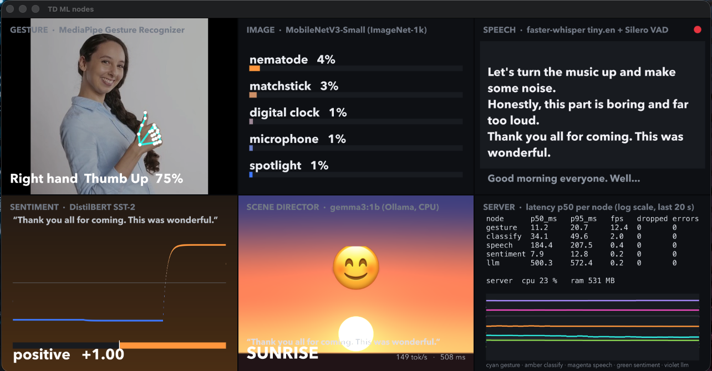
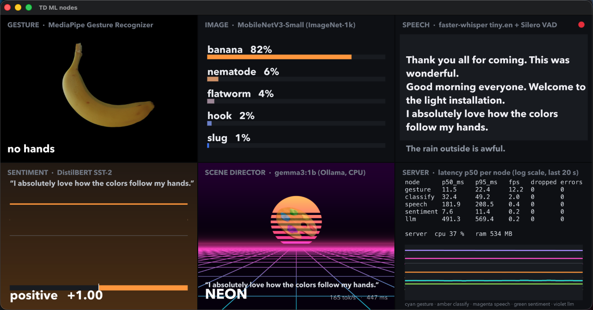

# AI отчет
Код доступен по ссылке [Github](https://github.com/atheostheos/modern-digital-products-2026.git)

## Постановка

**Задача:** демо интерактивной медиаинсталляции в TouchDesigner (TD), которая в реальном времени анализирует видео и аудио контент. Камера видит руки и жесты, микрофон слышит речь, по тексту речи
определяется настроение. 
Локальная LLM, орбабатывая полученный текст, выбирает визуальный образ.

### Демо визуализация



**Техническое задание:**
- 4 задачи с разным типом контента + LLM, для каждой создана отдельная нода TD;
- обработка в режиме реальное времени: TD держит 60 fps, модели не блокируют его основной поток;
- минимум 2 фреймворка (использовано 5);
- API хотя бы для одной модели (сделано для всех: WebSocket + REST);
- экономия ресурсов компьютера: для сохранения наибольшее кол-ва вычислительных ресурсов (в теории они потребуются для оставшейся части реальной медиаинсталяции) были ограничены кол-во поток и частота обработки кадров.

| Тип контента | Задача | Модель | Фреймворк | Вход → выход |
|---|---|---|---|---|
| Видео | Распознавание жестов и рук | MediaPipe Gesture Recognizer | MediaPipe | входящий кадр 256px → 21 точка на 1 руку + классификация 7-и жестов, отображаются обе руки |
| Изображение | Классификация | MobileNetV3-Small (ImageNet-1k) | PyTorch / torchvision (PyTorch Hub) | входящий кадр 224 px → top-5 классов |
| Аудио | Речь в текст (английский) | faster-whisper `tiny.en` + Silero VAD | CTranslate2 (веса с Hugging Face) | поток аудио → промежуточный и финальный текст фразы |
| Текст | Тональность | DistilBERT SST-2 | Hugging Face transformers | определение тональности текста |
| LLM | «Режиссёр сцены» | gemma3:1b (Q4_K_M) | Ollama / llama.cpp | по фразе определяется один из 6-и визуальных отображений |

**Архитектура:** TD захватывает весь вход (камера или видеофайл, микрофон или аудиофайл, текст)
и стримит его по WebSocket на локальный FastAPI сервер `127.0.0.1:8000`. Ответы возвращаются в TD как CHOP/DAT/TOP ноды и рисуются шейдерами.

```
TD: ml_input ─ видео ─▶ ml_gesture, ml_classify ─ JPEG ─▶ сервер ─▶ MediaPipe, torchvision
             ─ аудио ─▶ ml_speech ─ PCM ─▶ сервер ─▶ VAD → whisper
                          └ финальная фраза ─▶ ml_sentiment ─▶ DistilBERT
                          └ финальная фраза ─▶ ml_llm ─▶ gemma3:1b (Ollama, CPU)
TD: view_* + dashboard ◀── результаты и метрики (/ws/metrics)
```

**API:**
- WebSocket `/ws/{node}` для потоков;
- REST `POST /api/{node}` для одиночных запросов, например
  `curl -X POST /api/sentiment -d '{"text": "I love this"}'` → `valence 0.9998`;
- `/health`, `/metrics`, `/ws/metrics`.

Все ответы приходят в одном запросе сразу `{ok, node, seq, t_send, data, error, timing}`.

---

## 1. Причина выбора библиотек и приложений

| Библиотека | Причина | Где используется |
|---|---|---|
| **MediaPipe** (Google) | до этого на практике мною тоже использовался, один из самых качественных и быстрых инференсов для распознавания рук | жесты |
| **PyTorch / torchvision** (PyTorch Hub) | на практике более знаком с torch, чем tensorflow, удобный api | классификация |
| **faster-whisper** (CTranslate2) | другие варианты не искал, по качеству хорошо справляется с задачей, поэтому и оставил | речь |
| **Hugging Face transformers** | готовые моделей, `pipeline()` в одну строку, кэш весов, офлайн-режим | тональность |
| **Ollama** (llama.cpp) | удобный клиент, быстрый запуск, готовый API | LLM |
| **FastAPI + uvicorn** | полностью покрывает нужные требования, использован т.к. работал с ним | API |
| **TouchDesigner** | универсальный комбайн для создания аудио/видео реактивных визуалов + легкая интеграция собственных компонентов, поддержка python скриптов | клиент и визуал |

Из рекомендованных библиотек использованы Hugging Face и PyTorch Hub, плюс MediaPipe и Ollama.

## 2. Принцип работы моделей и причины выбора

### Видео — MediaPipe Gesture Recognizer
- **Принцип:**
  1. Лёгкий детектор находит ладонь.
  2. Модель точек руки регрессирует 21 3D-точку (суставы и кончики пальцев) и определяет,
     левая рука или правая.
  3. Небольшой классификатор по эмбеддингу точек выдаёт один из жестов:
     `None, Closed_Fist, Open_Palm, Pointing_Up, Thumb_Down, Thumb_Up, Victory, ILoveYou`.
- **Почему:**
  - даёт и жест, и скелет руки, интересный визуал + можно будет в дальнейшем использовать для более комплексного визуала;
  - ~10 мс на кадр на CPU;
  - 8 МБ;
  - до 2 рук.

### Изображение — MobileNetV3-Small
- **Принцип:** свёрточный нейронный классификатор для мобильных устройств. Взят для пробы и проверки нагрузки всей системы, в теории можно будет добавить реактивный визуал на классифицированный объект
- **Почему:**
  - 2.54 млн параметров;
  - ~30 мс на CPU;
  - веса и предобработка в torchvision «из коробки».

### Аудио — faster-whisper tiny.en + Silero VAD
- **Принцип:**
  - Whisper — трансформер encoder–decoder.
  - `tiny.en` — наименьшая (39 млн параметров) англоязычная версия.
  - Silero VAD отмечает, где в потоке речь. Собственный сегментатор режет речь на фразы:
    пауза 0.75 с → финал, промежуточная гипотеза каждые 1.5 с, максимум 10 с.
  - Whisper запускается только на фразах.
- **Почему:**
  - только английский был использован для сохранения качества ответов без излишней нагрузки;
  - самая быстрая модель семейства (RTF 0.063: клип 5.4 с распознаётся за 0.34 с);
  - VAD экономит CPU: распознаётся только ~12% аудиочанков.

### Текст — DistilBERT SST-2
- **Принцип:** DistilBERT — «сжатый» дистилляцией BERT: 6 слоёв вместо 12. По данным авторов,
  он на 40% меньше и на 60% быстрее, сохраняя ~97% качества. Дообучен на SST-2 (бинарная
  тональность). Из вероятностей считается `valence = positive − negative ∈ [−1, 1]` — одно
  число, удобное для управления цветом.
- **Почему:**
  - стандартная и самая популярная модель тональности на Hugging Face;
  - ~14 мс на фразу;
  - по карточке модели точность на SST-2 dev — 91.3%.
  - на практике можно тоже менять визуал в зависимости от настроения, текста песни.

### LLM — gemma3:1b (Ollama, CPU)
- **Принцип:** декодер-трансформер (Google Gemma 3, ~1 млрд параметров, контекст 32k),
  квантованный в Q4_K_M (806 МБ). Он генерирует ответ токен за токеном.
- **Роль в проекте — «режиссёр сцены».** На каждую законченную фразу модель
  принимает два решения:
  - какой из 6 визуалов подходит (`storm, sunrise, fireworks, ocean, neon, starfield`);
  - какой эмодзи передаёт смысл фразы.

  Ответы проверяются. Если ответ непригоден, срабатывает запасной вариант по тональности
  (valence > 0.3 → sunrise, < −0.3 → storm, иначе starfield).
- **Почему:**
  - модель очень маленькая: локально работает быстро, оставляет ОЗУ для создания визуала в TD;
  - выбор из фиксированного списка текстов 1B-модель делает надёжно (8/8 в пробе), для более сложных предложений возможно потребуется модель побольше.
  - в общем и целом с демонстрацией вполне справляется, другие модели не были опробованы из-за малого места на диске T-T.

## 3. Структура данных

**Данные инференса:**

| Узел | Формат сообщения | Частота |
|---|---|---|
| gesture | бинарный: заголовок `<Id` (seq, t_send) + JPEG 256×192 | 15 кадров/с |
| classify | то же, JPEG 224 px | 2 кадра/с |
| speech | бинарный: `<IdI` (seq, t_send, частота дискретизации) + float32 моно, ≤ 1 с; сервер ресемплирует в 16 кГц | чанки по 0.25 с |
| sentiment | JSON `{"seq", "t_send", "text"}` | на каждую финальную фразу |
| llm | JSON-сцена `{"speech", "gesture", "valence"}` или просто фраза | на каждую новую фразу, не чаще 1 раза в 2 с |

Ограничения на входе (валидация на сервере):
- кадр ≤ 4 МиБ и ≤ 1920² пикселей;
- текст ≤ 2000 символов;
- аудио 8–192 кГц, |x| ≤ 16.

Некорректные сообщения получают ответ-ошибку, соединение не рвётся.

**Тестовые данные:**
Для проверки работы без камеры и микрофона можно скачать изображения и синтезировать голос (`scripts/make_media.py`):
- `gestures.mp4` — 15 с, 640×480. Это 6 слайдов по 2 с: официальные фото MediaPipe
  (thumbs_up, victory, pointing_up, thumbs_down, две руки без жеста) и банан. Ожидаемые
  жесты лежат в `gestures.json`.
- `speech.wav` — 6 английских фраз, синтезированных `say`: 4 позитивные, 2 негативные. Ожидаемый
  текст и тональность лежат в `speech.json`.

Переключатель `button_live` в TD меняет записанные файлы на живые камеру и микрофон.

## 4. Метрики оценки качества

### Скорость инференса (ML-сервер, ~1 час непрерывной работы с TD)

| Узел | Запросов | Инференс p50 | p95 | Ответов/с | Отброшено | Ошибок |
|---|---|---|---|---|---|---|
| gesture (256 px) | 18 518 | 10.1 мс | 13.5 мс | 13.8 | 0 | 0 |
| classify (224 px) | 2 946 | 29.2 мс | 51.1 мс | 1.8 | 0 | 0 |
| speech (распознавание фразы) | 6 064 чанка / 704 распознавания | 182.8 мс | 201.8 мс | — | 0 | 0 |
| sentiment | 508 | 14.4 мс | 22.7 мс | — | 0 | 0 |
| llm (2 вызова LLM + рендер эмодзи) | 424 | 517 мс | 624 мс | — | 0 | 0 |

**Полный цикл (отправка → ответ получен клиентом):**

| Узел | Из TD | Из сервера напрямую (без TD) |
|---|---|---|
| gesture (включая кодирование JPEG) | 22 мс | 11 мс p50, 16 мс p95 |
| classify | 39 мс | 30 мс p50, 50 мс p95 |
| sentiment | 24 мс | — |
| speech: от конца фразы до готового текста | 189 мс | 182 мс p50, 185 мс p95 (на старте проекта 294 мс) |
| llm: от фразы до выбранного мира и эмодзи | 0.51 с | 0.50–0.62 с |

Из TD разница с сервером в основном от того, что ответы обрабатываются на границах кадров
(1 кадр = 16.7 мс).

**Загрузка моделей**:

| Модель | Время загрузки | Память |
|---|---|---|
| sentiment | 10.0 с | +496 МБ, включая сам torch |
| speech | 4.6 с | +302 МБ |
| gesture | 1.1 с | +110 МБ |
| classify | 0.9 с | +14 МБ |

Все модели запускаются за ~14 с.

**Отдельные операции:**
- VAD — 0.71 мс на чанк 0.25 с;
- ресемплинг 48→16 кГц — 0.5 мс на чанк;
- рендер эмодзи — 6–21 мс;
- генерация gemma3:1b на CPU — ~50–66 токенов/с.

Для проверки скорости в TD сделан дисплей по метрикам

### Качество на контрольных примерах

| Узел | Результат |
|---|---|
| gesture | 4/4 фото MediaPipe распознаны верно (уверенность 0.73–0.91), на фото с двумя руками найдены обе; на видео 6/6 сегментов верно |
| speech | 6/6 фраз слово в слово, кроме пунктуации и «colours» → «colors» |
| sentiment | 5/6 верно; ошибка: «Let's turn the music up and make some noise.» → negative −0.98 (идиома вне домена рецензий на фильмы) |
| classify | банан → banana 0.55; на фото рук — шум («mask», «nematode»): в ImageNet нет класса «рука», стилизованные картинки тоже ошибочны (но в целом их лучше использовать для отдельных проектов, вместе вряд ли что-то получится) |
| llm | 8/8 визуалов и 8/8 эмодзи в пробе; примеры: «I absolutely love how the colors follow my hands.» → сцена neon + эмодзи палитры, «The rain outside is awful…» → storm, «Let's turn the music up…» → fireworks + жест козы |

### Продуктовые метрики
- **Задержка реакции:**
  - от жеста до скелета на экране — 2–3 кадра при 60 fps;
  - от конца фразы до смены мира — ≈ 0.8–0.9 с: текст 0.18 с, тональность 0.02 с, LLM 0.5–0.6 с;
  - после этого идёт плавный переход 0.8 с.
- **Плавность:** TD держит 60 fps со всеми узлами, шестью визуализациями и дашбордом.
- **Метрики для реальной инсталляции:**
  - время сессии посетителя;
  - число фраз и жестов на посетителя;
  - доля реакций по запасному варианту (сколько раз LLM не дала пригодный ответ);
  - доля фраз без распознанного текста.

### Инфраструктурные метрики

| Процесс | CPU | RAM |
|---|---|---|
| TouchDesigner | 50.7% | 371 МБ |
| ML-сервер | 20–36% | 520 МБ, 59 потоков |
| Ollama (gemma3:1b на CPU) | ~3% в простое | 864 МБ |

- GPU моделями не используется — он полностью отдан TD.
- За час работы — 0 отброшенных запросов и 0 ошибок.
- Дашборд TD показывает метрики сервера вживую: p50/p95, fps, потери, CPU и RAM по каждой ноде.

## 5. Особенности реализации и эффективность

- **Передача кадров.** В TD кадр читается через `numpyArray(delayed=True)` (без остановки GPU)
  и кодируется в JPEG через cv2.

  | Способ кодирования | Время в основном потоке TD |
  |---|---|
  | numpy + cv2 | 1.34 мс |
  | `saveByteArray` | 6.19 мс |

  Полный цикл передачи (RTT) — 7–11 мс, то есть около 1 кадра. Транспорт пренебрежимо мал по
  сравнению с инференсом.
- **Отброс старых кадров при задержке.** У каждой модели свой поток и один слот ожидания.
  Если модель не успевает, старые кадры отбрасываются, а не копятся в очереди, и задержка не
  растёт. JPEG декодируется уже в потоке модели, поэтому отброшенные кадры даже не декодируются.
- **Ограниченная очередь ответов.** Не больше 8 ответов на соединение, таймаут отправки 2 с.
- **Обработка речи разбита на отдельные сессии.** Для каждого соединения своя сессия: ресемплинг → VAD → сегментатор →
  whisper. Whisper общий, однопоточный. Очередь — до 40 чанков (~10 с аудио); при
  переполнении клиент получает уведомление о потере.
- **Экономия CPU:**
  - частоты отправки: жесты 15 кадров/с, классификация 2 кадра/с;
  - ограничение потоков torch и CTranslate2;
  - whisper запускается только на речи.
- **LLM на CPU.** На GPU (Metal) gemma3:1b выдавала мусор: 0/10 валидных ответов, повторы вида
  «model model model». Веса при этом проверены, контрольная сумма совпала. На CPU — 12/12
  осмысленных ответов. Это проблема связки Metal + macOS 26 + Ollama 0.40.3 на M5. CPU-режим
  заодно оставляет GPU для TD.
- **Устойчивость:**
  - некорректные ответы сервера считаются ошибками узла и не ломают TD;
  - клиенты TD сами переподключаются после перезапуска сервера (проверено);
  - LLM ждёт тональность именно текущей фразы (до 1 с), чтобы запасной вариант был корректным.
- **Код и тесты:**
  - сервер — 144 теста, покрытие 95%, плюс отдельные тесты с реальными моделями (`-m models`);
  - код узлов TD хранится файлами в `td/`, TD подхватывает правки на лету;
  - каждый узел пересобирается скриптом и сохранён как `.tox`.

## Заключение
Четыре задачи с разным контентом (видео, изображение, аудио, текст) и локальная LLM решены
готовыми моделями на пяти фреймворках:
- MediaPipe;
- PyTorch / torchvision;
- CTranslate2 (faster-whisper);
- Hugging Face transformers;
- Ollama.

Все модели собраны в один локальный сервер с WebSocket и REST API и подключены к TouchDesigner
как узлы с визуализацией. Всё работает в режиме реального времени:
- жесты — ~10 мс;
- классификация — ~30 мс;
- тональность — ~14 мс;
- речь — ~0.18 с от конца фразы;
- LLM — ~0.5 с.

TD при этом держит 60 fps без потерь и ошибок за час работы. Полученный инференс можно в дальнейшем использовать для создания более комплексного аудио и видео реактивного визуала.
