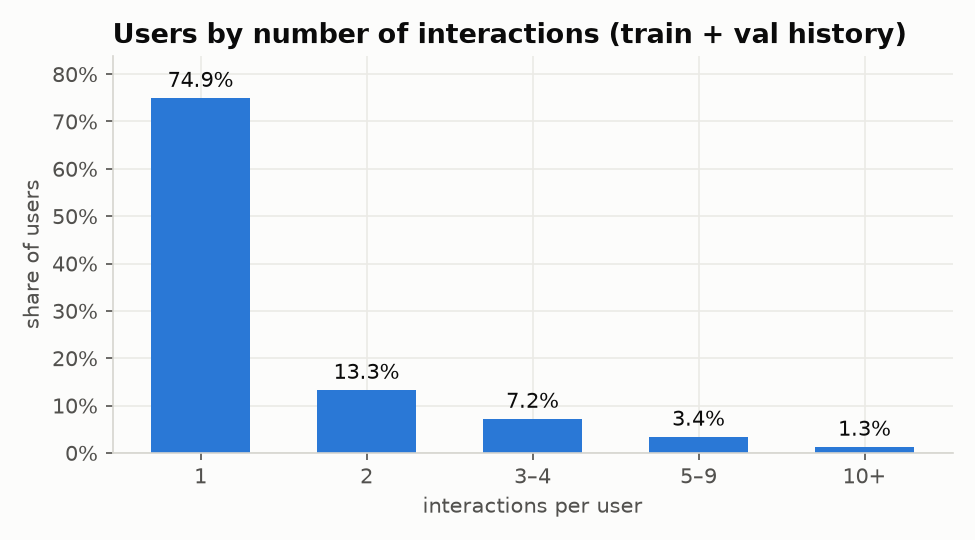
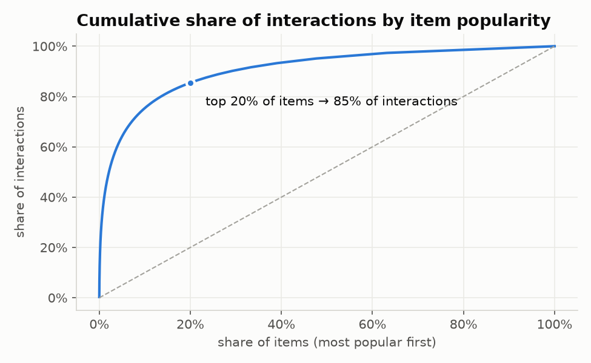
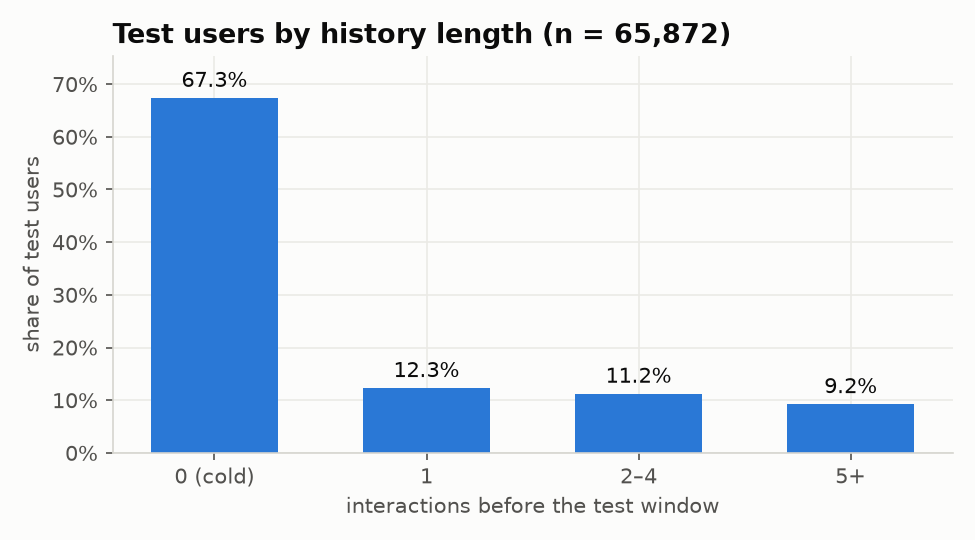

# Recsys отчет
Код доступен по ссылке [Github](https://github.com/atheostheos/modern-digital-products-2026.git).

## Постановка
 
**Задача:** персонализировать
витрину при помощи рекомендательной системы — показать каждому покупателю товары, которые он с наибольшей вероятностью купит, и тем самым увеличить конверсию, средний чек и продажи ассортимента «длинного хвоста».

**Данные:** [Amazon Reviews 2023](https://amazon-reviews-2023.github.io/main.html) в категории Musical_Instruments — 3.0 млн отзывов, 1.76 млн пользователей, ~214 тыс. товаров
за 1999–2023 годы (дополнительно имеются карточки товаров: название, описание, категории, бренд, цена).
В данном иследовании oтзыв рассматривается как неявный сигнал интереса (implicit feedback): 67% оценок — пятёрки,
поэтому важен сам факт взаимодействия, а не оценка.

**Ключевые свойства данных по EDA:**
- экстремальная разреженность: плотность 7.9e-6, у 75% пользователей ровно 1 отзыв:
  
- концентрация спроса: 20% товаров дают 85.5% взаимодействий:
  
- 67% пользователей тестового периода — новые (без истории); 12.5% спроса — на новые товары:
  
- ограничения: нет просмотров и сессий, поле «покупают вместе» пустое, цена есть у 40% товаров.

**Протокол оценки:** временное разбиение — обучение на данных до 2022-10-01, подбор
гиперпараметров на окт–дек 2022, финальная оценка на янв–мар 2023 (модель обучена на всём до
2023-01-01). Метрики top-10 по всем пользователям и по сегментам истории; пользователь без
рекомендаций засчитывается как промах.

---

## Часть I. Реализованные подходы

Использованы готовые библиотеки: **RePlay** (Сбер, на PySpark), **implicit** (для ALS),
**scikit-learn**; собственный код — только адаптеры, гибрид и анализ.

| Группа | Модель | Суть |
|---|---|---|
| Бизнес-эвристики | Популярное | самые популярные товары за всё время |
| | Тренды (сезонность) | популярное за последние 365 дней |
| | Популярное в категории | топ основной категории пользователя |
| | Популярное у бренда | топ основного бренда пользователя |
| | «С этим товаром также покупают» | ассоциативные правила по совместным отзывам |
| Классические | Content-based | TF-IDF текста товара → LSA, профиль = последний товар («похоже на недавно просмотренное») |
| | Item-based CF | ItemKNN, 100 соседей |
| | User-based CF | UserKNN, 400 соседей |
| | Матричная факторизация | ALS (неявная обратная связь), ранг 32 |
| Гибрид | Hybrid | взвешенный Reciprocal Rank Fusion: правила + UserKNN + ALS + контент + тренды (fallback для новых пользователей) |

**Результаты по тестовой выборке**

HitRate@10 — доля пользователей с хотя бы одним угаданным товаром

| Модель | Все | Новые (67%) | С историей (33%) | 5+ покупок | NDCG@10 | Покрытие каталога |
|---|---|---|---|---|---|---|
| **Гибрид** | **0.0245** | **0.0264** | **0.0205** | 0.0259 | **0.0127** | 6.1% |
| Тренды | 0.0213 | 0.0264 | 0.0106 | 0.0072 | 0.0113 | 0.01% |
| «Также покупают» | 0.0066 | – | 0.0201 | **0.0280** | 0.0026 | 5.9% |
| UserKNN | 0.0040 | – | 0.0122 | 0.0120 | 0.0018 | 14.9% |
| ALS | 0.0038 | – | 0.0118 | 0.0138 | 0.0014 | 0.1% |
| Популярное | 0.0098 | 0.0099 | 0.0095 | 0.0104 | 0.0045 | 0.01% |
| Content-based | 0.0029 | – | 0.0087 | 0.0102 | 0.0013 | 33.5% |
| ItemKNN | 0.0012 | – | 0.0036 | 0.0048 | 0.0004 | 31.9% |

**Выводы части I:**
- Гибрид лучше всех в целом: +15% HitRate и +12% NDCG к лучшей одиночной модели.
- Простая эвристика «тренды за год» — сильнейшая одиночная модель, потому что 2/3
  пользователей новые; она вдвое лучше «популярного за всё время».
- Среди персональных моделей лучше всех работают ассоциативные правила; для пользователей
  с большой историей они даже лучше гибрида.
- Классические CF-методы страдают от разреженности; сильнее всех — item-based.
- Возможно количества используемых данных в виду разреженности недостаточно для объективной оценки более сложных методов в виду разреженности данных.

---

## Часть II a. Проблемы конкретных подходов

### 1. Холодный старт пользователей
- **Проблема:** 67% тестовых пользователей без истории. Все персональные модели
  (правила, CF, ALS, контент, категории/бренды) для них не работают — HitRate = 0.
- **Решение (реализовано):** fallback на «тренды за год» внутри гибрида — новые получают
  трендовые товары (HitRate 0.0264 против 0.0099 у «просто популярного»). Дополнительно
  возможна короткая анкета при регистрации (выбор инструментов/жанров).
- **Недостаток решения:** тренды не персональны — все новые видят одно и то же; анкета
  увеличивает отток на старте.
- **Вариант подхода:** применить лучшие практики в нужное время — использовать любой доступный контекст без анкеты
  (поисковый запрос, источник перехода, первая просмотренная страница → content-based по
  одному товару), быстро переключаться на персональные модели после 1–2 действий и
  добавлять бандитов, чтобы собирать сигнал о новых пользователях.

### 2. Холодный старт товаров
- **Проблема:** 12.5% спроса в тесте — на товары, у которых не было ни одного отзыва.
  Коллаборативные модели и популярность их принципиально не рекомендуют.
- **Решение (реализовано):** контентная модель по тексту и бренду — единственная, которая
  показывает новые товары (6.2% её позиций).
- **Недостаток решения:** угадывает лишь 0.4% спроса на новые товары; в гибриде её вклад
  в новые товары теряется (у гибрида 0 таких позиций).
- **Вариант подхода:** выделять в выдаче квоту «новинки» (exploration slots), использовать
  метаданные и изображения, ускоренный сбор сигнала для новых товаров.

### 3. Разреженность данных
- **Проблема:** медиана 2 взаимодействия на товар, 75% пользователей с одним отзывом.
  Сходства в ItemKNN шумные (HitRate тёплых пользователей 0.0036 — худший результат среди всех моделей).
- **Решение:** модели, обобщающие через скрытые факторы (ALS), более «широкие» соседства
  (у UserKNN на валидации точность выросла с 0.0043 до 0.0173 при увеличении числа соседей
  с 20 до 400), гибридизация с контентом.
- **Недостаток решения:** больше соседей и факторизация усиливают смещение к популярному
  (доля длинного хвоста у UserKNN упала с 0.27 до 0.16).
- **Вариант подхода:** главное средство — больше сигналов (просмотры, корзины, поиск), которые
  в реальном сервисе в десятки раз плотнее отзывов.

### 4. Смещение к популярному и «пузырь фильтров»
- **Проблема:** тренды и ALS охватывают < 0.1% каталога и не показывают длинный хвост;
  контентная модель имеет аналогичную проблему (разнообразие категорий в списке 0.21 против
  0.68–0.83 у CF-моделей; у «популярного в категории» — 0.10 по построению).
- **Решение:** переранжирование на разнообразие (MMR), квоты на длинный хвост, ограничение
  частоты показов одного товара, калибровка под интересы пользователя.
- **Недостаток решения:** измеренный компромисс — модели с широким охватом (контент,
  ItemKNN: треть каталога, 63–89% хвоста) наименее точны.
- **Обсуждение:** баланс задаётся бизнес-целью (оборот хитов или продажи ассортимента) и
  проверяется A/B-тестом с метриками точности и разнообразия одновременно.

### 5. Справедливость к продавцам (брендам)
- **Проблема:** реальный спрос распределён по 6 953 брендам (топ-10 — 11%), а популярностные
  модели отдают топ-10 брендам 100% показов; ALS — 72%, гибрид — 73%.
- **Решение:** ограничения экспозиции на продавца, нормировка популярности внутри категорий,
  бренд-разнообразие в списке.
- **Недостаток решения:** ограничения снижают точность и могут противоречить интересам
  крупных продавцов-партнёров.
- **Обсуждение:** для маркетплейса это не только этика, но и экономика платформы: мелкие
  продавцы уходят, если не получают трафика.

### 6. Этические проблемы и качество рекомендаций
- **Проблема:** «Также покупают» и популярность не учитывают качество: товар становится
  популярным и при плохих отзывах; контентная модель вообще не смотрит на оценки и показывает
  больше всех плохо оценённых товаров (2.6% позиций против 1.1% в реальных покупках).
  Отдельный риск — **накрутка отзывов**: фейковые отзывы поднимают товар в тренды и правила.
- **Решение:** фильтр/штраф за низкий рейтинг при достаточном числе оценок, вес только
  подтверждённых покупок, обнаружение аномальных всплесков отзывов, blocklist категорий,
  которые нельзя рекомендовать «в связке».
- **Недостаток решения:** фильтр по рейтингу прячет нишевые товары с малым числом оценок;
  антифрод даёт ложные срабатывания.
- **Вариант подхода:** модерация на уровне данных + мониторинг доли плохо оценённых
  товаров в выдаче как guardrail-метрики.

### 7. Объяснимость
- **Проблема:** ALS и гибрид не объясняют, «почему мне это показали».
- **Решение:** подписи от объяснимых компонент («потому что вы смотрели X» — правила,
  ItemKNN, контент).
- **Недостаток:** объяснение может не совпадать с реальной причиной ранга в гибриде.

### 8. Сезонность и устаревание
- **Проблема:** популярность меняется во времени (пики в декабре и в 2020–2021 годах).
- **Решение (реализовано):** окно популярности подобрано на валидации — 365 дней лучше
  30 дней и «всего времени» (0.0213 против 0.0098 у «всего времени» на тесте).
- **Недостаток:** короткие окна шумные и «выжигают» хиты у постоянных пользователей
  (у «тяжёлых» 30-дневные тренды проваливаются).

---

## Часть II b. Проблемы в продакшене

### 1. Медленный ответ из-за распределённого движка
- **Проблема:** модель RePlay на Spark отвечает на одиночный запрос за **≈10 с и больше**
  (1 пользователь ≈ 1000 пользователей по времени — фиксированные накладные расходы Spark).
  Модели в одном процессе (implicit, scikit-learn, polars) — за 4–33 мс. Это проблема связана исключительно с заточенностью RePlay на Spark и ее запуском на локальной машине без распределнной систмы.
- **Решение:** ночной пакетный пересчёт рекомендаций для всех пользователей → key-value
  хранилище.
- **Недостаток решения:** рекомендации устаревают до следующего пересчёта; новый пользователь
  получает только fallback.
- **Обсуждение:** стандарт — двухстадийная схема: заранее посчитанные кандидаты + лёгкое
  онлайн-переранжирование по свежим действиям (сессия, корзина), тренды пересчитываются чаще.

### 2. Свежесть данных и дрейф
- **Проблема:** данные «стареют»: даже обучение только на последних двух годах улучшило
  «популярное» (0.0146 против 0.0094 на валидации); тренды меняются по сезонам.
- **Решение:** регулярный пересчёт, мониторинг свежести и распределений (популярность
  рекомендованных товаров, покрытие, доля новых товаров).
- **Недостаток:** частые пересчёты дороже; без мониторинга деградация незаметна.

### 3. Петля обратной связи и смещение оценки
- **Проблема:** в продакшене пользователи кликают по тому, что им показали, — данные
  начинают отражать модель, офлайн-метрики завышаются, модель усиливает собственные
  предпочтения (популярное становится ещё популярнее).
- **Решение:** доля exploration-показов, логирование показов (а не только кликов),
  контрольная группа без персонализации.
- **Недостаток:** exploration кратковременно снижает метрики.

---

## Часть III. Оценка в продакшене: ML- и бизнес-метрики, мониторинг

**Офлайн-метрики (использованы в проекте):** HitRate, Precision, Recall, NDCG, MAP, MRR @10/@20;
покрытие каталога, Gini, доля длинного хвоста, Surprisal, разнообразие категорий;
бизнес-прокси (средняя цена, «захваченная выручка»), концентрация брендов, доля новых и плохо
оценённых товаров; время обучения и задержки p50/p95. Всё — по сегментам истории пользователя.

**Онлайн-оценка (A/B-тест):**
- главная метрика — выручка на пользователя / конверсия в покупку;
- вовлечённость — CTR блока рекомендаций, добавления в корзину, доля заказов с участием
  рекомендаций;
- долгосрочные — retention, частота покупок;
- ассортимент — доля продаж длинного хвоста, число продавцов с продажами;
- guardrails — задержка p95, ошибки, возвраты и жалобы, средний чек.

Дизайн: рандомизация по пользователю, ≥ 2 недели, расчёт размера выборки (пример: для
конверсии 2% и эффекта +5% нужно ~314 тыс. пользователей на группу), анализ по сегментам.
Путь: офлайн → shadow → A/B → постепенный раскат.

**Мониторинг:** качество (CTR/конверсия по дням и сегментам, доля fallback и пустых списков),
данные (свежесть, дрейф популярности, покрытие, концентрация брендов), система (задержки,
ошибки, успешность ночного пересчёта), согласованность офлайн- и онлайн-метрик.

---

## Чего ждёт бизнес и что реально

| Ожидание бизнеса | Что показывают данные |
|---|---|
| Персонализация для всех | 2/3 покупателей — новые; им можно показать только тренды |
| Рост выручки за счёт рекомендаций | Офлайн гибрид «угадывает» 1.3% стоимости реальных покупок; причинный прирост покажет только A/B |
| Продажи длинного хвоста | Точные модели концентрируются на хитах (гибрид: 6% каталога, 73% показов у топ-10 брендов) |
| «Умные» модели лучше простых | Тренды за год — сильнейшая одиночная модель; выигрыш гибрида +15% |
| Мгновенная работа | Возможно только с заранее посчитанными списками (~1 мкс); надо проверить эффективность Spark на распределенной систме |

**Реалистичный итог:** наибольший эффект дадут не более сложные модели, а **правильная
стратегия для новых пользователей (свежие тренды) и сбор более богатых сигналов**
(просмотры, корзины). Персонализация заметно помогает трети аудитории с историей.

## Уязвимости решений
- Холодный старт — главная уязвимость всех персональных моделей.
- Накрутка отзывов влияет на тренды и ассоциативные правила.
- Смещение к популярному и концентрация на крупных брендах.
- Отзыв — неполный прокси покупки; «также покупают» построено на совместных отзывах.

## Как улучшить
1. **Данные:** события просмотров/корзины/покупок и сессии вместо отзывов.
2. **Модели:** двухстадийная схема — генерация кандидатов (текущие модели) + learning-to-rank
   (например, градиентный бустинг по признакам пользователя, товара, цены, рейтинга, свежести);
   последовательные модели (SASRec/BERT4Rec) для «следующей покупки».
3. **Холодный старт:** контекстные признаки, бандиты, квоты на новинки.
4. **Качество и этика:** штраф за низкий рейтинг, антифрод отзывов, ограничения экспозиции
   брендов, переранжирование на разнообразие.
5. **Продакшен:** ночной пересчёт + KV-хранилище + онлайн-переранжирование; более частый
   пересчёт трендов; приближённый поиск соседей для контентной модели; мониторинг дрейфа.

## Заключение
Реализованы пять бизнес-эвристик, четыре классических подхода и гибрид на готовых
библиотеках; проведена временная офлайн-оценка с анализом по сегментам,
разнообразию, справедливости, бизнес-прокси и скорости. Гибрид лучший (+15% HitRate),
но главные ограничения задаёт не модель, а данные: разреженность, доля новых пользователей и
отсутствие богатых сигналов.
